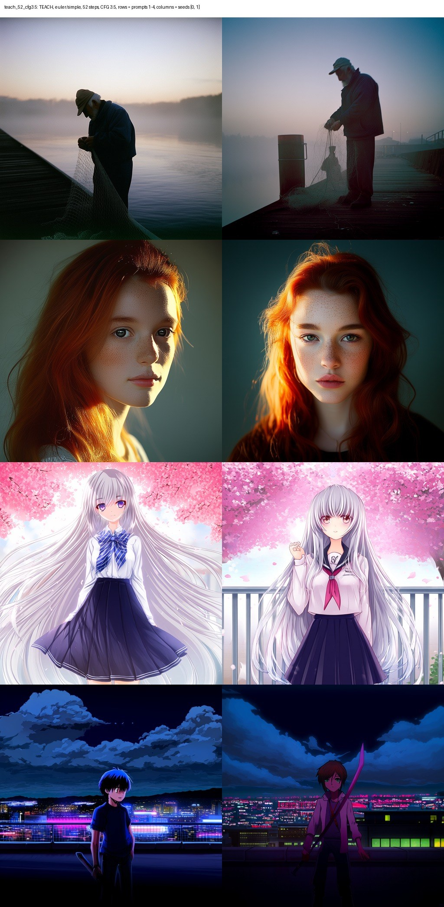
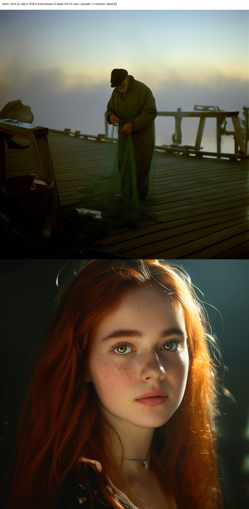
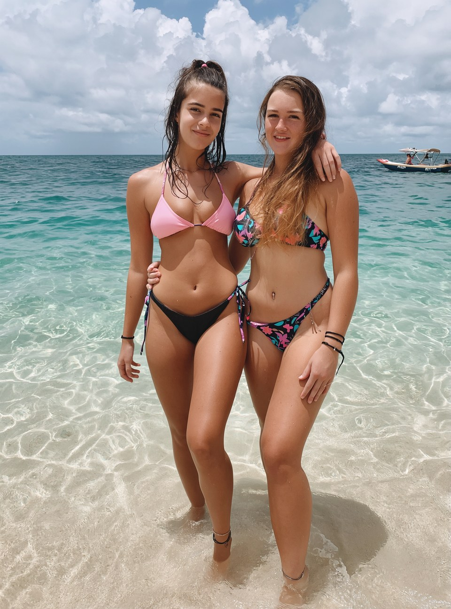
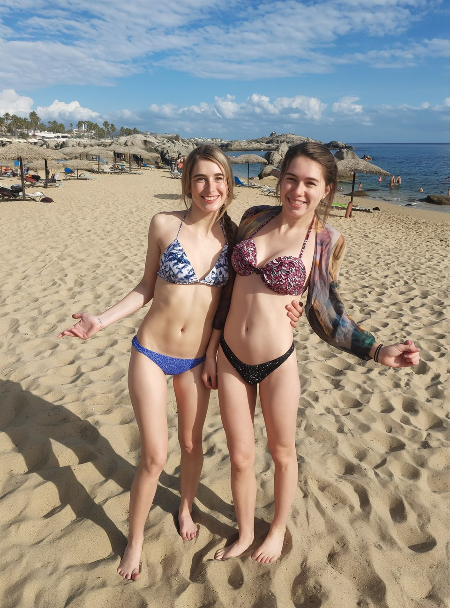
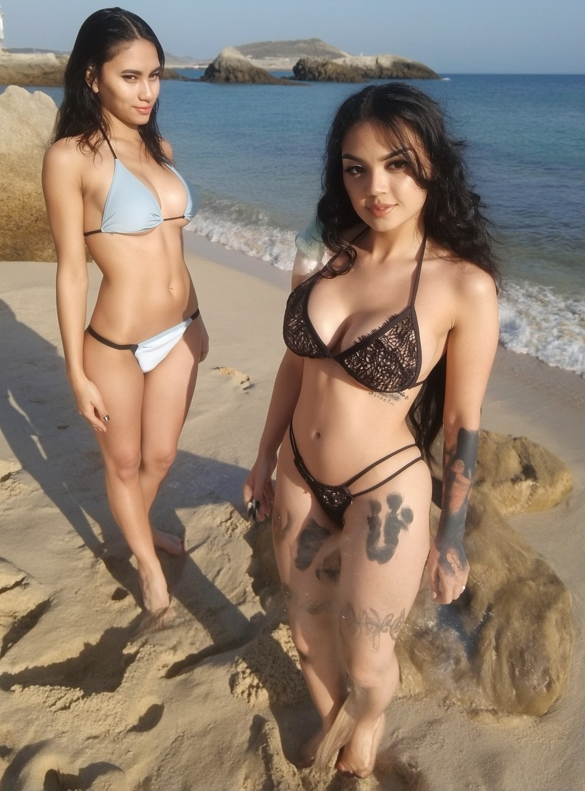
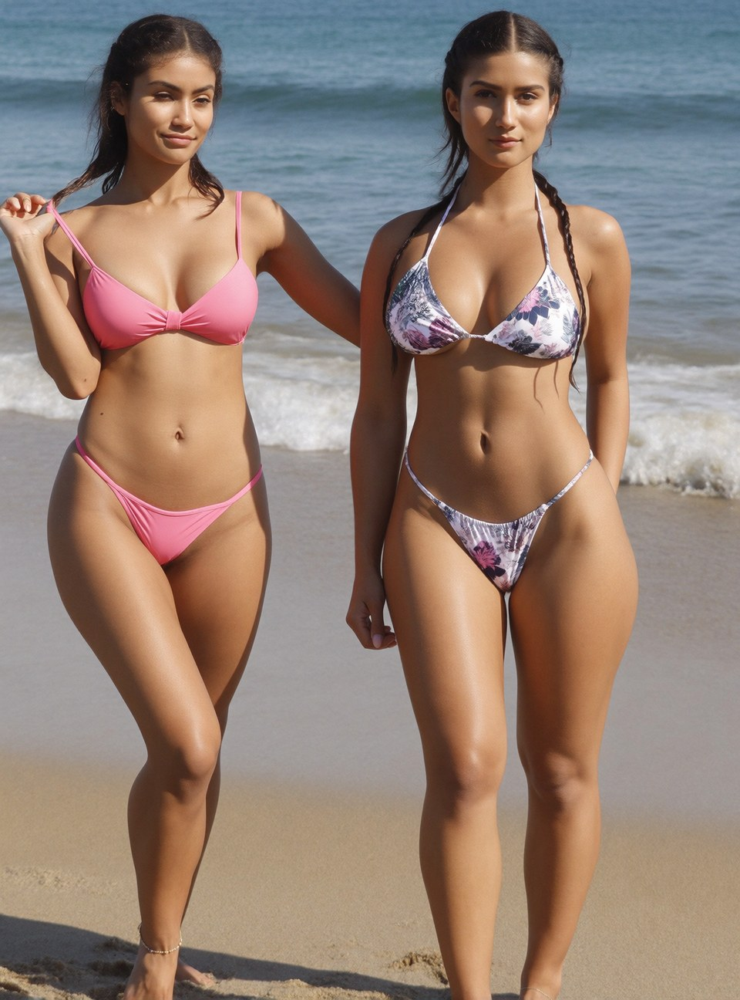
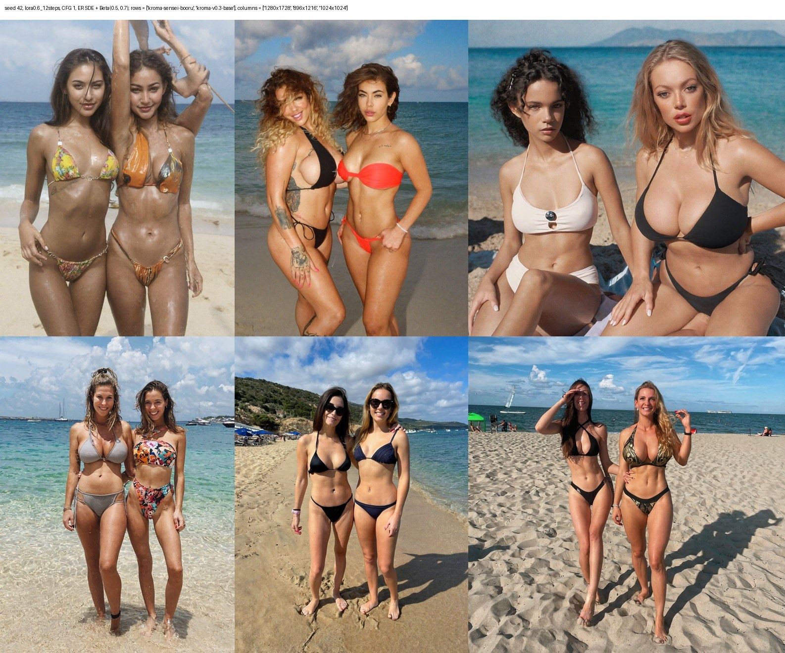
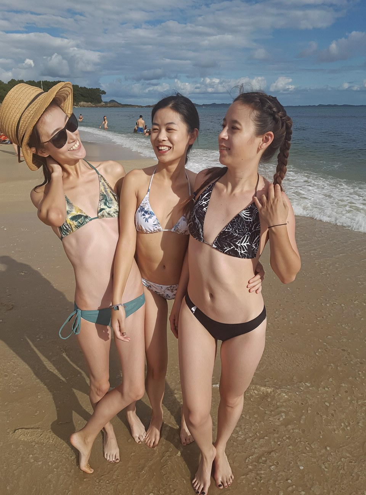
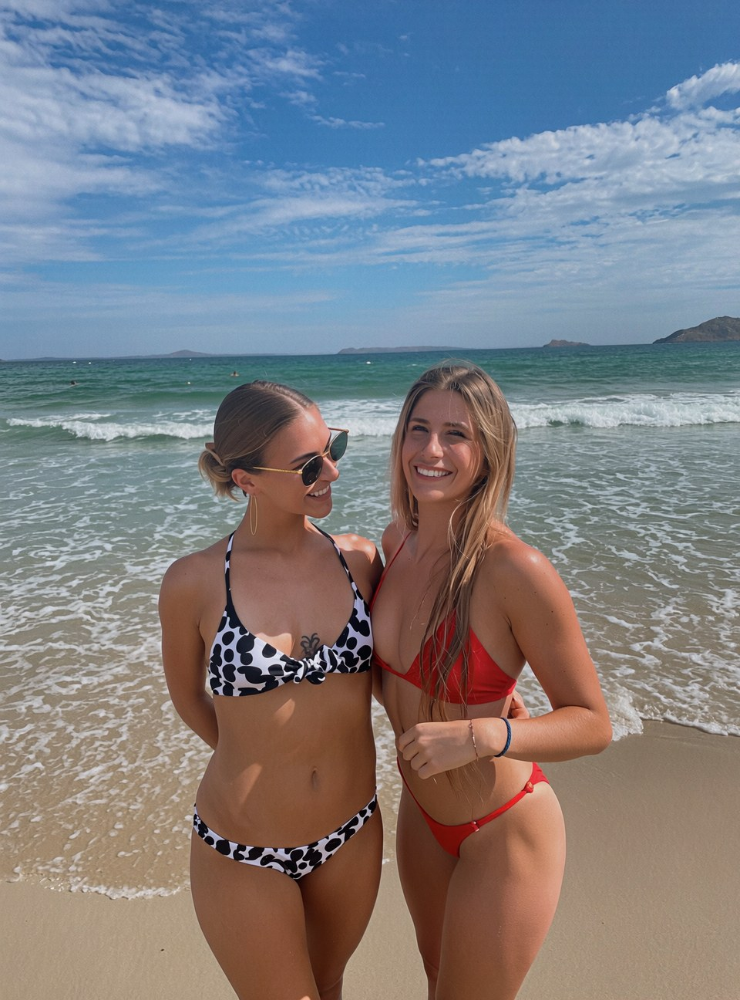

# Rebuild kroma-v0.3.1-turbo-opd

## What I set out to do

Kroma v0.3.1 ships as `kroma-v0.3.1-turbo-opd`, a fast Turbo checkpoint said to come from on-policy distillation (OPD) with `kroma-sensei-booru-e6-teacher-velocity-v0.3` as the teacher. I wanted to learn how that distillation works: what the teacher passed on, and where it shows in the weights.

## There is no distillation in OPD

Here's what the [official Kroma page](https://huggingface.co/lodestones/Kroma) says about the **`kroma-v0.3.1-turbo-opd.safetensors`** checkpoint:

> **What OPD is:** v0.3.1 was distilled **on-policy**. Instead of the classic offline recipe — imitating the teacher on a fixed sampling schedule, which slowly pulls the student off the original data manifold — the student generates its own trajectories and the teacher corrects it **on those exact points**. Training only ever happens on states the model actually visits, so the distilled model **stays inside the original model's distribution**: Turbo speed without the usual distillation tax (mode collapse, washed-out detail, prompts that suddenly stop working).

My analysis - and a bunch of experiments - demonstrate that there is no on-policy distillation in this checkpoint. Instead, it's a merge: **the official Krea 2 Turbo** plus the **biggest 10 % of the teacher's changes to Krea 2 Raw**. The teacher's **text blocks are copied whole**; the card gives no reason. My guess is that this was meant to keep prompt adherence for the new knowledge.

Four experiments:

1. **Weight differences.** I compared each Kroma file with Krea 2 Raw, tensor by tensor, against the official Turbo change (**Turbo − Raw**). Kroma v0.3 base holds none of it. OPD holds all of it, at full strength in every DiT block, and none in the text blocks.
2. **Metadata.** OPD names its own inputs: Raw as base, Turbo as target, the teacher as fine-tune, `trim 0.9`, text blocks copied from the teacher.
3. **Subtraction.** I removed the Turbo change from OPD exactly. Raw plus a tenth of the teacher's change was left. In every tensor, 90 % of OPD's elements equal Turbo bit for bit, and the rest equal Turbo plus the teacher's change.
4. **Rebuild.** One formula over Raw, Turbo and the teacher gives OPD in all but one of 12.8 billion elements. Training would have moved nearly every weight. None moved.

OPD is a merge: the official Krea 2 Turbo, plus the biggest tenth of the teacher's change, plus the teacher's text blocks. Its speed is Krea's own distillation. REPORT.md compares this with the model card.

### What the author says

In [discussion #28](https://huggingface.co/lodestones/Kroma/discussions/28) the author says the actual OPD training ran thousands of LoRAs in parallel to distill the knowledge back into Krea Turbo. Nothing in the published file supports this.

- `kroma-v0.3.1-turbo-opd` holds three things: the official Turbo, 10 % of (teacher − Raw), and the teacher's text blocks. It matches that formula in all but one element. LoRAs from an OPD run could reach the release only through the teacher.
- If they sit inside the teacher, the teacher is that run's product. Even so, its weights show no distillation: no baked-in guidance, and at 8 steps it is as blurry as the base.
- The change added to Turbo does not look like something trained on Turbo either. It is measured from Raw, holds all of the base's own training, and was trimmed to its biggest 10 %. That recipe suits a Raw-side fine-tune.
- The weights cannot show what the author ran. They do show that the few-step speed is Krea's official Turbo, and that Kroma's share arrived through a merge.

## What the teacher is

The weights say the teacher holds Kroma v0.3 base whole and adds a second change as large as the base's own training, in new directions. It has no Turbo change and no baked-in guidance, and it predicts velocity the standard way, like any Krea 2 model. Its change spreads over about four times more directions than the base's and touches nearly every element. The author describes the teacher as many LoRAs merged by a non-standard method ([discussion #28](https://huggingface.co/lodestones/Kroma/discussions/28)), and the weights fit that: a sum of many LoRAs looks like this, with no single LoRA or LoKr behind it.

"booru" and "e6" in the name point at its data, anime image boards and e621. It shows. Ask for "two girls in bikini on a beach" without the word "photo": the base draws a photo, the teacher draws booru anime, down to an artist's signature in the corner.

At 512 and 1024 px the teacher renders clean images. These are my tests: 4 prompts × 2 seeds, 52 steps, CFG 3.5, Euler.

| Kroma v0.3 base, 512 px | Teacher, 512 px |
|---|---|
|  |  |

| Teacher, 1024 px |
|---|
|  |

At 1280 × 1728 (2.2 MP) it breaks. These are my own generations in Forge Neo: 12 steps, CFG 1, ER SDE, Krea 2 Turbo LoRA at 0.6, int8 copies of the models.

| Base, "Two girls…" | Teacher, "Two girls…" |
|---|---|
|  |  |

| Base, "A photo of two women…", Turbo LoRA at 0.6, 12 steps | Teacher, same seed, same Turbo LoRA at 0.6, 12 steps | Teacher, but Turbo LoRA bumped to 1.0, 8 steps |
|---|---|---|
|  |  |  |

The teacher's photo has a phantom hand by the right woman's shoulder, smeared tattoos and feet melting into the sand, at lower contrast. A full-strength Turbo LoRA hides the faults.

The same seed at three sizes, with bf16 models and the stock ER SDE and Beta scheduler: teacher on top, base below; 1280 × 1728, 896 × 1216 and 1024 × 1024. At 2.2 MP the teacher grows a third raised arm; at about 1 MP it draws two women correctly. The base is clean at every size. The teacher was most likely trained at about 1 MP.



OPD inherits the fault. Raw plus OPD's share of the teacher, at 1280 × 1728, draws three women for "two women" and swaps their feet. With the SPEED extension, which runs the first, high-noise steps at half resolution, the same seed comes out right.

| Raw + OPD's teacher share | Same, with SPEED (high-noise timesteps at half resolution) |
|---|---|
|  |  |

## Proof: the script

The script rebuilds kroma-v0.3.1-turbo-opd from three public files. It measures what the Kroma teacher changed in Krea 2 Raw, keeps the biggest tenth of those changes in every tensor, and adds them to Krea 2 Turbo. The text side comes from the teacher whole. It reads and writes one tensor at a time, so memory use stays at a few GB.

The rebuild matches the published OPD in all but one of its 12.8 billion elements. [REPORT.md](REPORT.md) has the details.

## Files

| Role | File |
|---|---|
| RAW | `raw.safetensors` (Krea 2 Raw) |
| TURBO | `turbo.safetensors` (Krea 2 Turbo) |
| TEACH | `kroma-sensei-booru-e6-teacher-velocity-v0.3.safetensors` |
| OPD, for `--compare` only | `kroma-v0.3.1-turbo-opd.safetensors` |

All inputs must be bf16 or fp32. The script refuses fp8 and int8 files.

## Blocks

| Tensors | Result |
|---|---|
| `blocks.0` to `blocks.27`, `tmlp`, `tproj`, `first`, `last` | Turbo plus the trimmed teacher change |
| `txtfusion`, `txtmlp` | Teacher as is |

The first row covers every tensor in those modules: weights, norm scales, modulation vectors and biases.

## Math

For each tensor W:

- Δ = W_TEACH − W_RAW
- τ = the 0.9 quantile of |Δ| with linear interpolation, as `torch.quantile` computes it
- M = 1 where |Δ| > τ, 0 elsewhere
- W_OUT = W_TURBO + M ⊙ Δ

On the text side, W_OUT = W_TEACH.

The comparison is strict, so values equal to τ are dropped. A bf16 delta has many such ties, and its tensors keep a little under 10 %.

The sum is computed in fp32 and stored in Raw's dtype for that tensor, so the output has Raw's layout: 256 bf16 and 174 fp32 tensors.

## Usage

```bash
python rebuild_opd.py --raw RAW --turbo TURBO --teach TEACH -o OUTPUT --compare OPD
```

`--density` sets the kept share (default 0.1, the published trim 0.9). `--threshold topk` keeps the exact top share with ties included; the default `quantile` reproduces OPD. `--copy-prefixes` sets the tensors taken from the teacher whole (default `txtfusion.,txtmlp.`). `--compare` prints, per module group, the share of bit-identical elements and the error relative to the size of the change.

`count_diff.py A B` counts differing elements per tensor. `diagnose_mask.py` compares the OPD trim mask with the rebuilt one.

The script needs Python with torch and numpy.
